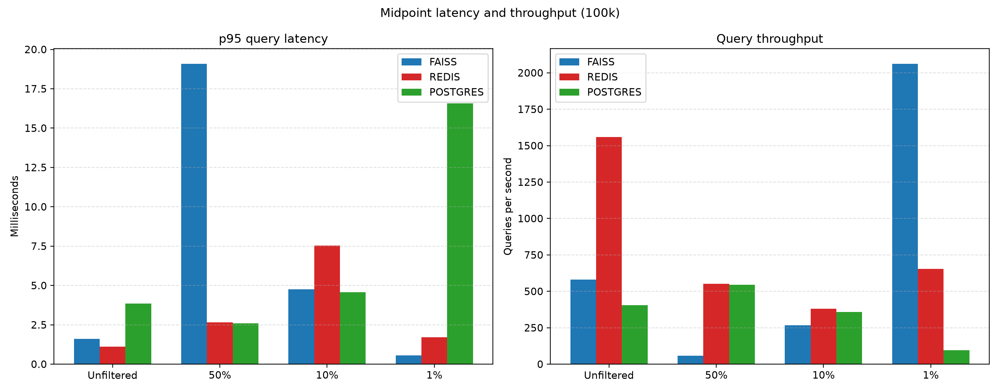
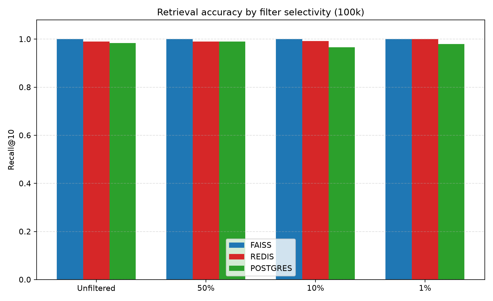
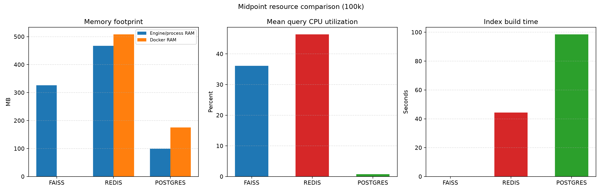

# RAG retrieval storage-engine benchmark

This project evaluates retrieval for Retrieval-Augmented Generation as a data
systems problem. The same 100,000 TREC-COVID passage embeddings and synthetic
metadata are searched with FAISS, Redis Stack, and PostgreSQL/pgvector. The
midpoint workload measures filtered and unfiltered Recall@10, query latency,
throughput, index-build time, RAM, and CPU usage.

## Midpoint status

The midpoint implementation and one complete 100k validation run are present:

- pinned Redis Stack and PostgreSQL/pgvector Docker images with fixed limits;
- 100k normalized, 384-dimensional `all-MiniLM-L6-v2` passage embeddings;
- deterministic metadata with nested 50%, 10%, and 1% filter masks;
- exact brute-force top-10 ground truth for every filter level;
- shared loaders and benchmark output schemas for all three backends;
- per-query latency CSVs, summary CSVs, index-build CSVs, and comparison plots.

Generated datasets are intentionally excluded from Git because
`passages_100k.npy` is approximately 146 MB. The small midpoint results and
figures under `results/` are included for review.

## Repository layout

```text
faiss/                       FAISS backend and benchmark scripts
redis/                       Redis Stack loader and benchmark scripts
postgres/                    pgvector loader and benchmark scripts
tests/                       Ground-truth unit tests
results/                     Midpoint CSVs and comparison figures
docker-compose.yml           Pinned Redis and PostgreSQL services
verify_and_test_pipeline.py  Dataset, metadata, and ground-truth generator
plot_midpoint.py             Canonical cross-backend figure generator
GROUND_TRUTH.md              Detailed artifact-generation instructions
```

## Reproduce the midpoint run

Use Python 3.11 or 3.12. The recorded run used Python 3.12.10 on an Apple M3
Pro with 18 GB RAM and Docker 29.3.1.

```sh
python3.12 -m venv .venv
source .venv/bin/activate
python -m pip install -r requirements.txt
```

Place the BEIR TREC-COVID source files under `data/trec-covid/`, then generate
the shared 100k artifacts:

```sh
python verify_and_test_pipeline.py --num-passages 100000
```

Start the databases and wait until both services are healthy:

```sh
docker compose up -d --wait
docker compose ps
```

Run each backend from the repository root. `DATASET_SUFFIX=100k` is explicit so
the scripts cannot accidentally select the 1k test artifacts.

```sh
python faiss/evaluate_faiss.py

DATASET_SUFFIX=100k python redis/load_and_index.py
DATASET_SUFFIX=100k python redis/bench_selectivity.py

DATASET_SUFFIX=100k python postgres/load_and_index.py
DATASET_SUFFIX=100k python postgres/bench_selectivity.py

python plot_midpoint.py --suffix 100k
```

Stop the services without deleting the PostgreSQL volume:

```sh
docker compose stop
```

## Preliminary midpoint results

These numbers are from one run and are evidence that the full pipeline works;
they are not the final multi-trial results.

| Backend | Build time (s) | Unfiltered p95 (ms) | Unfiltered QPS | Unfiltered Recall@10 |
|---|---:|---:|---:|---:|
| FAISS | 0.185 | 1.610 | 579.93 | 1.000 |
| Redis | 44.348 | 1.120 | 1559.22 | 0.990 |
| PostgreSQL | 98.490 | 3.861 | 405.33 | 0.984 |

The preliminary results show that Redis delivered the highest unfiltered
throughput but used more memory. FAISS exact search achieved Recall@10 of 1.0.
Its filtered prototype rebuilds a temporary exact index for every query, so its
50% filter cost is intentionally visible. PostgreSQL retrieval remained near
the exact ground truth, while the 1% predicate required more search work.

### Midpoint figures







## Measurement limitations

- The committed midpoint results contain one run; the final evaluation will
  use at least three trials and report medians and spread.
- CPU values are preliminary because FAISS is a host process while Redis and
  PostgreSQL run in containers. Final resource experiments will use a common
  sampling interval and normalization method.
- FAISS uses exact `IndexFlatIP` at the midpoint. Redis and PostgreSQL use HNSW
  with their current search-effort settings, explaining Recall@10 below 1.0.
- Benchmarks were executed sequentially, but both database containers were
  running. Final controlled trials will stop the unused backend.

## Artifact integrity

`data/processed/manifest_100k.json` records the model, seed, shapes, artifact
sizes, query ordering, and SHA-256 checksums. Every backend returns the shared
`row_idx` identifiers and is evaluated against the same exact ground truth.

## AI assistance

AI assistance was used for code integration, test generation, path and output
standardization, debugging, and documentation. The generated code was reviewed
through compilation, unit tests, Docker health checks, full 100k index builds,
backend benchmarks, and visual inspection of the result figures. Team members
remain responsible for reviewing the implementation and interpreting results.
